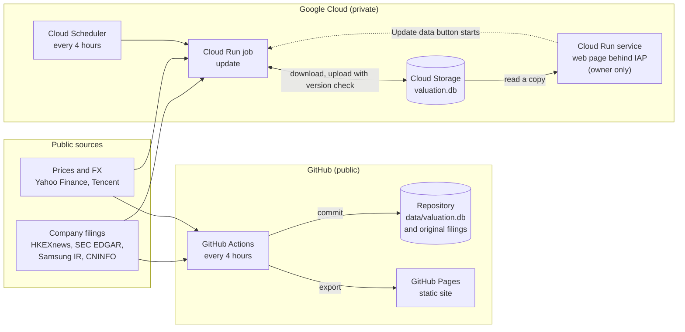

# Stock Valuation Monitor

A personal research tool that answers one question: **is a stock's valuation (PE, PS, PB) high or low compared with its own history?**
For ten companies in four markets (Hong Kong, US, Korea, China A-shares) it reads the numbers from the companies' own
earnings filings, joins them with daily prices, and shows today's multiple as a percentile of the last 1 to 10 years.
Every number can be traced back to the filing it came from, and the page shows the exact calculation behind any day on a chart.

**Live demo** (read-only, refreshed every 4 hours): https://yun-zhsh.github.io/Watchlist-monitor/


*Hovering over a day on a trend chart shows the whole calculation: close price, FX rate, and the quarterly EPS it was built from.*

## Architecture

The same Python package runs in two places: on GitHub (a public static site) and on Google Cloud (a private dynamic page that only the
owner can sign in to, so the diagram is how everyone else sees it).



## Design decisions and trade-offs

**Original filings, not a data vendor.** The numbers come straight from the exchange and regulator filings (HKEXnews, SEC EDGAR,
Samsung's investor site, CNINFO), parsed by this project. That makes every figure verifiable, gives the exact publication time of
each one, and costs nothing. The price is one parser per filing layout (seven so far) and maintenance when a layout changes.
This is a personal research project: prices come from free sources such as Yahoo Finance (cross-checked against Tencent for Hong Kong
stocks), whereas a production system would use licensed vendor data. All multiples are trailing, built from reported history. Forward
multiples need analyst estimates, which only professional data providers license; once such a series exists it should slot in as
one more per-share metric, because the percentile, charts and audit trail work on any per-share series.

**No look-ahead.** A reported figure is used only from the first trading day on which the market could have seen it: the publication time
(to the minute where the source gives it) is compared with each exchange's closing time, half days included, and the effective day is
taken from the days that actually traded. The cost is a calendar and a time rule per source, kept in `market_calendar.py` and the providers.

**Fail loudly rather than guess.** A filing that cannot be parsed raises an error instead of producing a best-effort number. The same
value is cross-checked across every filing that repeats it, a disagreement is reported, and the first published value is the one used.
The cost is that a new company or layout shows nothing until its parser exists; the benefit is that a wrong number is much harder to miss.

**SQLite in a bucket object, not a managed database.** The workload is one batch writer every few hours and a few MB of data (about 0.8 MB
per company). A SQLite file fits that, and the same code runs unchanged on a laptop, in GitHub Actions and on Cloud Run. In the cloud the
update job downloads the file from Cloud Storage, updates it and uploads it only if nobody else uploaded in between (a generation
precondition), so two runs can never overwrite each other; the web page reads a copy. The trade-offs: a single writer and no concurrent
edits, which is fine here and would not be for many users. A managed database (Cloud SQL, Postgres) would cost money every month and add
a service to run for no benefit at this size. How the repository grows, and when to change the storage, is measured in
[docs/database-growth.md](docs/database-growth.md).

**An AI assistant gets the same guardrails.** `valuation-monitor-mcp` is an [MCP server](docs/mcp-server.md) that lets an assistant such as
Claude look up valuations. It is read-only (the database is opened in SQLite's read-only mode and the network is off), every result carries
its sources (filing link, publication time, effective trading day and the written-out calculation), every tool takes an `as_of` date so only
data that was public by then is used, and all arithmetic stays in Python so the model only calls tools and explains the result. The cost is
that the assistant can only answer what the tools offer, in return a wrong or unsourced number is hard to produce and easy to catch.

**Status:** v0.4.2. Project conventions (English-only code and output, tests, how the data is written) are in [CLAUDE.md](CLAUDE.md).

## What it tracks

| Stock | Metrics | Earnings filings |
| --- | --- | --- |
| Meta Platforms META | PE, PS, PB (USD, US GAAP, basic EPS; no Non-GAAP EPS is used) | Quarterly, earnings press releases (exhibit 99.1 of Form 8-K item 2.02) on SEC EDGAR, `us_press_release` layout |
| Cognizant Technology Solutions CTSH | PE, PS, PB (USD, US GAAP, basic EPS; the company's adjusted diluted EPS is not used) | Quarterly, the same, `us_press_release` layout |
| ASML Holding ASML | PE, PS, PB; the price is USD per NY registry share (the NASDAQ line, one share = one ordinary share), earnings are in EUR and converted with each day's EURUSD rate | Quarterly, the summary US GAAP financial statements furnished with each 6-K on SEC EDGAR, `us_gaap_statements` layout |
| Samsung Electronics 005930.KS | PE, PS, PB (price and financials are both in KRW; no Non-GAAP data) | Quarterly, English consolidated financial statements on the Samsung IR website, `kifrs_statements` layout |
| XP Inc. XP | PE, PS, PB; the price is USD per Class A common share (listed directly on NASDAQ, no ADS), earnings are in BRL under IFRS and converted with each day's BRLUSD rate; the company's adjusted (Non-GAAP) figures are not used | Quarterly, the IFRS consolidated financial statements furnished on 6-K on SEC EDGAR (interim statements each quarter, audited annual statements for Q4), `ifrs_statements` layout |
| JD.com (ADR) JD | PE, PE (Non-GAAP), PS, PB; the price is USD per ADS, EPS is RMB per ADS | Quarterly, 6-K press releases on SEC EDGAR, `press_release` layout |
| Tencent Holdings 0700.HK | PE (IFRS), PE (Non-IFRS), PS, PB | Quarterly, `highlights` layout |
| Sunny Optical Technology 2382.HK | PE, PS, PB (only HKFRS data is disclosed, no Non-IFRS) | Half-yearly (interim, annual), `statements` layout |
| Hikvision 002415.SZ | PE, PS, PB (A-share, RMB; the company discloses no Non-GAAP data) | Quarterly, Chinese periodic reports and annual express reports on CNINFO, `cn_report` layout |
| Glodon 002410.SZ | PE, PS, PB (A-share, RMB; no Non-GAAP data) | Quarterly, Chinese periodic reports and half-year and annual express reports on CNINFO, `cn_report` layout |
| Zhongji Innolight 300308.SZ | PE, PS, PB (A-share on ChiNext, RMB; no Non-GAAP data) | Quarterly, Chinese periodic reports on CNINFO, `cn_report` layout |
| China Northern Rare Earth 600111.SS | PE, PS, PB (A-share on the Shanghai Stock Exchange, RMB; no Non-GAAP data) | Quarterly, Chinese periodic reports and half-year and annual express reports on CNINFO, `cn_report` layout |
| Bank of Nanjing 601009.SS | PE, PS, PB (A-share on the Shanghai Stock Exchange, RMB; a commercial bank: revenue is the operating income including net interest income, PB uses the equity of the ordinary shareholders) | Quarterly, Chinese periodic reports and half-year and annual express reports on CNINFO, `cn_report` layout |


The code is designed around "many stocks x many metrics": to add a stock, edit the config; to add a metric, write a metric class (see "Extending").

## Quick start

Python 3.10 or later is required. Install:

```bash
python3 -m venv .venv && .venv/bin/pip install -e '.[dev]'
```

### Identifying yourself to SEC EDGAR

US company filings come from SEC EDGAR. EDGAR requires every request to say who is making it (a contact in the User-Agent), otherwise it refuses (HTTP 403), and it limits requests to 10 per second (the program uses about 5 per second). The contact is not written in the code; it is provided through an environment variable:

```bash
export SEC_USER_AGENT="valuation-monitor your-email"
```

Without this variable the program does not contact EDGAR and uses the filings already saved in `data/filings/` (newly published filings can only be fetched once it is set). The online site (GitHub Actions) reads the repository secret `SEC_USER_AGENT`: repository Settings -> Secrets and variables -> Actions -> New repository secret, name `SEC_USER_AGENT`, value as above. Never commit it.

### Web interface

```bash
.venv/bin/valuation-monitor-web
```

On start it first updates the data (a few seconds to a dozen or so), then opens http://127.0.0.1:8050/ in the browser. Press Ctrl+C to quit.

- **History selector**: the drop-down at the top right chooses which period the historical percentile is computed over: the past 10, 5, 3, 2 or 1 years (default 10). The percentile and level on the home page, the metric cards on a stock page, and the time range and percentile lines of the trend charts all follow it. The choice is remembered and carried to other pages (the URL gets `?years=5`; share that URL and the other person sees the same choice). The results for every number of years are computed when the page is generated, so the online (static) site can switch too.
- **Home page**: lists all tracked stocks with the latest price, the current value of each metric, its historical percentile and valuation level.
- **Stock page**: click a stock. It shows:
  - the current value and historical percentile of each metric, with a bar marking the current position;
  - a trend chart for each metric (with P10-P90 percentile lines) and a price chart;
  - data sources and cross-check status;
  - download buttons: historical prices, historical earnings, per-share metrics (with formulas), daily valuation detail, all raw data (zip). The CSVs have English column names (file names such as `0700.HK_historical_prices.csv`) and open directly in Excel.
  - **Checking the calculation**: hover over a day on a trend chart to see the full formula of that day's ratio, e.g. `PE = close / (per-share value x FX rate) = 232,000 KRW / (32,308 KRW x 1) = 7.18`, followed by how the per-share value was obtained (`TTM EPS = 2025Q4 2,874* + 2026Q1 7,123 + 2026Q2 10,849 + 2026Q3 11,462 = 32,308`; for PS and PB it also lists the revenue of each period, and how equity and shares were obtained), which period of earnings it came from and when that was published.
- **Update data**: the button at the top right fetches the latest prices and filings over the network. A line at the top of the page then says whether new data was loaded or there was none (on Google Cloud, while the update job runs, that it is still running).

Options: `--port` sets the port (default 8050), `--no-browser` does not open the browser; `-c`, `--data-dir` and `--refresh` are the same as in the CLI. By default only the local machine may connect.

### Online site (GitHub Pages)

URL: https://yun-zhsh.github.io/Watchlist-monitor/ (works on phones and computers)

GitHub Actions (`.github/workflows/pages.yml`) runs every 4 hours, i.e. at 9:47, 13:47, 17:47, 21:47, 1:47 and 5:47 Hong Kong time (GitHub does not guarantee punctuality; it may be a few minutes to over half an hour late). Each run:

1. updates prices and filings, and commits any change back to the `data/` directory of the repository;
2. exports a static site with the same pages as the local site (without the "Update data" button) and publishes it to GitHub Pages.

A push to `main` also triggers a run. To update immediately, open the repository's Actions page, choose "Update data and publish site" and click "Run workflow". A manual run tests the code first, like a push; tick "data_only" to skip the tests and only update the data, as a scheduled run does (on `main` only). This is for the case where a saved-data test fails just because the data of a newly added stock is still incomplete.

Notes:

- Before first use, set Source to "GitHub Actions" in repository Settings -> Pages.
- The repository is public, so anyone can open the site.
- If a public repository has no activity for 60 days, GitHub disables scheduled workflows automatically; re-enable them on the Actions page.
- You can also export the static site locally: `.venv/bin/valuation-monitor-export --out site`.

### Running on Google Cloud (dynamic page, only you can open it)

The page can also run on Google Cloud Run: a scheduled Cloud Run job (`valuation-monitor-update`) fetches the data every
4 hours, the page (served with gunicorn, `valuation_monitor.web.wsgi:app`) shows it and lets you start an update with the
"Update data" button, and Identity-Aware Proxy lets only your Google account in. The SQLite database is kept as an object in a
Cloud Storage bucket: the job downloads it, updates it and uploads it back (refusing if someone else uploaded a newer version
in the meantime), and the page reads a downloaded copy (`cloud.py`). The `Dockerfile` builds one image used for both.
Step-by-step instructions are in [docs/deploy-google-cloud.md](docs/deploy-google-cloud.md). It runs side by side with the
GitHub Pages site.

### Command line

```bash
.venv/bin/valuation-monitor --plot charts
```

Example output (values of 2026-11-02; they change with prices; the stocks are printed in turn, only Tencent is shown here):

```
Tencent Holdings (0700.HK)  Earnings source: HKEXnews, 48 original earnings filings, currency CNY
  ⚠ Non-IFRS EPS 2015Q1 differs between filings (probably a restatement) [0.759, 0.776]; using the first published value 0.759
  Earnings detail  table periods in data/valuation.db
  Price check  Tencent vs Yahoo (after undoing Yahoo's adjustments): Agree 2451 days, Tencent only 10 days (details: table prices_final in data/valuation.db)

Tencent Holdings (0700.HK)  PE (TTM)
  Date        2026-11-02
  Current     12.78
  Percentile  4.7%  ->  Deeply undervalued
  Window      2016-11-02 ~ 2026-11-02 (2460 trading days)
  Range       min 10.0 / mean 28.8 / max 59.7
  Bands       P10=13.9  P30=19.3  P50=25.4  P70=37.2  P90=47.9

Tencent Holdings (0700.HK)  PE Non-IFRS (TTM)
  Current     11.08
  Percentile  0.3%  ->  Deeply undervalued
  ...

Tencent Holdings (0700.HK)  PS (TTM)
  Current     3.81
  Percentile  0.9%  ->  Deeply undervalued
  ...

Tencent Holdings (0700.HK)  PB
  Current     2.64
  Percentile  0.6%  ->  Deeply undervalued
  ...
```

Options:

- `-c`: path of the config file.
- `--plot DIR`: write the trend charts.
- `--data-dir`: directory where data is saved (default `data`).
- `--refresh`: ignore the 12-hour network request cache (the `.cache/` directory).

## Using it from an AI assistant (MCP server)

```bash
pip install -e '.[mcp]'
claude mcp add valuation-monitor -- valuation-monitor-mcp --data-dir /path/to/Watchlist-monitor/data
```

Then ask, for example, *"Where does Samsung's PB stand over the last ten years?"*. The assistant calls `get_valuation`, and the answer
rests on a result like this (real output from the saved data, shortened):

```
PB = close / (per-share value x FX rate) = 229,000 KRW / (91,301.3691 KRW x 1) = 2.5082
percentile 92.6 of 2,429 trading days (2016-11-02 to 2026-11-02), level "Deeply overvalued"
earnings used: 2026Q3, published 2026-10-29 10:00 (Asia/Seoul), in effect from 2026-10-29
source: https://images.samsung.com/is/content/samsung/assets/global/ir/docs/2026_3Q_conference_eng.pdf
warning: the latest earnings used are preliminary (earnings call presentation, not yet the audited statements)
```

With `as_of="2025-03-31"` the same question gives PB 1.00 at the 4.1th percentile, from the 2024 Q4 statements published on 2025-01-31: nothing
published later is used (where a later document replaced a first release, the answer says so). The four rules (read-only, sourced, point in time, no model arithmetic), the tools, the setup for Claude Desktop and
Claude Code, running it as a **public read-only Cloud Run service** (`scripts/deploy-cloud.sh mcp`, so an assistant anywhere can use it by a
URL; rate-limited, a service account that can only read the bucket), and the limits are in [docs/mcp-server.md](docs/mcp-server.md).

## Saved data

Everything the program saves lives in `data/` and is committed to the repository with the code: one **SQLite database**, `data/valuation.db`, for prices, FX rates, parsed filings and earnings, plus the original filings as files. Later runs only add what is new; when the network is down the saved data is used.

| Where | Content | Updated by |
| --- | --- | --- |
| `data/filings/0700.HK/*.pdf`, `index.json` | Original earnings announcement PDFs (49 since 2014, about 20MB); the index records title, publication time and source link | Only newly published announcements are downloaded |
| `data/filings/META/*.htm`, `data/filings/CTSH/*.htm`, `index.json` | Original earnings press release HTML (exhibit 99.1 of the 8-Ks, 48 and 49 since 2014, about 16MB each); the index records every 8-K with item 2.02 that was checked | Only newly filed 8-Ks are checked and downloaded |
| `data/filings/ASML/*.htm`, `index.json` | ASML's summary US GAAP financial statements (the exhibit of each quarterly 6-K that has the income statement and balance sheet; 48 since 2014, about 26MB: the 2016-2024 ones are large because the statements are converted slides); the index records every 6-K that was checked | Only newly filed 6-Ks are checked and downloaded |
| `data/filings/XP/*.htm`, `index.json` | XP's IFRS consolidated financial statements (the interim statements of each quarter and the audited annual statements; 28 from the first quarter of 2020, the first quarter of 2021 twice, about 36MB); the index records every 6-K that was checked | Only newly filed 6-Ks are checked and downloaded |
| `data/filings/JD/*.htm`, `index.json` | Original JD earnings press release HTML (49 since 2014, about 23MB); the index records every 6-K that was checked (including non-earnings ones) so they are not checked again | Only newly filed 6-Ks are checked and downloaded |
| `data/filings/2382.HK/*.pdf`, `index.json` | Original Sunny Optical earnings announcement PDFs (24 since 2014); same index | Only newly published announcements are downloaded |
| `data/filings/005930.KS/*.pdf`, `index.json` | Excerpts of Samsung's English financial statements: consolidated statement of income (`soi`), of financial position (`bs`), and the EPS note page (`*_eps.pdf`); while the latest quarter's statements are not out, the earnings call material is kept temporarily; the index records the earnings call time | Only newly published quarters are downloaded |
| `data/filings/002415.SZ/*.pdf`, `index.json` | Relevant pages of Hikvision's original Chinese periodic and express reports (about 59 since 2014, about 29MB); the index records publication time, the basis for it and the source link (titles in the index are English) | Only newly published filings are downloaded |
| `data/filings/002410.SZ/*.pdf`, `index.json` | The same for Glodon (about 67 since 2013, about 25MB) | Only newly published filings are downloaded |
| `data/filings/300308.SZ/*.pdf`, `index.json` | The same for Zhongji Innolight (about 63 since 2013, about 25MB) | Only newly published filings are downloaded |
| `data/filings/600111.SS/*.pdf`, `index.json` | The same for China Northern Rare Earth (about 51 since 2015, about 25MB) | Only newly published filings are downloaded |
| `data/filings/601009.SS/*.pdf`, `index.json` | The same for Bank of Nanjing (56 since the 2014 annual report, about 37MB: a bank's annual and half-year reports repeat the item names on many pages, so their excerpts keep 30-46 pages) | Only newly published filings are downloaded |
| `data/valuation.db`, table `price_bars` | Daily bars of each source and symbol: Tencent (open, high, low, close, volume, **unadjusted actual traded prices**; HK stocks only) and Yahoo (close ex-rights adjusted, adjclose further adjusted for dividends) | Only trading days after the last saved day are inserted; when Yahoo adjusts history retroactively the series is downloaded again |
| table `fx_rates` | Daily FX rates of RMB to HKD and USD (USD is for JD) | Only new trading days are inserted |
| table `prices_final` | **The final closing price decided from all sources**, plus source, cross-check status, the price of each source and the Yahoo adjustment factor | Decided again on every run; only changed days are written |
| table `meta` | One JSON document per series: source note, where the download starts, currency, split records | Updated with the series |
| table `announcements` | Values parsed from each filing as stated: revenue, net profit attributable to owners, basic EPS, Non-IFRS/Non-GAAP basic EPS, equity at period end, shares disclosed in the filing, plus whether the data is preliminary, the basis of the share count and a publication time note | Only new filings are parsed |
| table `periods` | Per-period (quarter; half year for half-yearly reporters) revenue, net profit attributable to owners, EPS, equity at period end, weighted average shares disclosed in the filing (`wa_shares`), implied shares (for cross-checking), with first publication time, effective trading day, number of confirming filings, largest deviation and source link | Recomputed from `announcements` on every run; rewritten only if it changed |
| table `ttm` | The per-share data used for valuation after each filing, **with the full calculation**: EPS and revenue of each period the TTM covers (periods 1-4), the TTM total, latest net profit and basic EPS, shares, revenue per share, equity at period end, book value per share, and the formula text of every step; also publication time, available date, effective trading day, whether the data is preliminary and the split adjustment note | Same |

Notes:

- **Looking at the data**: any SQLite tool opens `data/valuation.db` (for example `sqlite3 data/valuation.db "select * from prices_final where symbol = '0700.HK' order by date desc limit 5"`). The page's download buttons give CSV files, and `python -m valuation_monitor.legacy export-csv DIR` (also installed as `valuation-monitor-db export-csv DIR`) writes the whole database as CSV and JSON files (`prices/<symbol>/...`, `fx/...`, `eps/<symbol>_<table>.csv`), the layout used before the database existed. `import-csv DIR` reads such a folder back; the round trip is byte for byte.
- **Why a binary file in git**: the database is small (a few MB for ten companies) and only changed rows are written, so the repository grows slowly. How fast it grows, what the original filings add, and when to review and change the approach are in [docs/database-growth.md](docs/database-growth.md). The program never rebuilds or vacuums the file, and the scheduled workflow fails if it grows over 50MB, as a reminder to stop keeping it in git. Do not commit it from a local run: only the scheduled workflow does, and a binary file cannot be merged. If `git pull` complains about local changes to it, `git checkout data/valuation.db` drops them.
- Raw traded prices and FX rates are never changed once saved. On every incremental download the program compares the last 7 saved days with the source and gives a notice if the source changed its history.
- Yahoo's adjusted prices change retroactively with new ex-rights events by nature; when a change is found the whole series is downloaded again (older versions of the database are still in git history).
- Today's prices can still change before the close, so they take part in the calculation but are not saved. Whether a day has "closed" is decided in each source's own timezone: Hong Kong time for HK stocks, London time for Yahoo FX.
- After the parsing rules are improved (add 1 to the number of the layout in `PARSER_VERSIONS` in `filings.py`) the saved parse results are invalidated automatically and parsed again.
- Other features can read the database directly; every table has a `symbol` (or `pair`) column that tells the stocks apart.
- The schema version is kept in SQLite's `user_version`; a database written by a newer version of the program is refused instead of being damaged.

## How to check the calculation

Every number can be traced back to the raw data step by step; the pages and the download files use the same formula text (`audit.py`):

1. **Chart tooltip** (cursor on a day): ratio = close / (per-share value x FX rate), with that day's close, FX rate and per-share value substituted; the per-share value is expanded into the sum of the TTM periods (or TTM revenue / shares, equity / shares; shares are taken from the figure disclosed in the filing first and only implied from net profit / basic EPS if none is disclosed, see "Shares").
2. **Daily valuation detail** (`valuation.csv`): for each trading day and each metric, one row with the close, price source, FX rate, which period of earnings was used that day (reporting period and publication time), the per-share value (reporting currency and converted) and the ratio. The ratio column = close / converted per-share value, which can be checked directly in Excel.
3. **Per-share metrics** (`ttm.csv`): one row per filing; after finding the period in the daily valuation detail, this lists the value of each period the TTM covers (periods 1-4), the total and the formula. For example Samsung 2026Q3: `TTM EPS = 2025Q4 2,874* + 2026Q1 7,123 + 2026Q2 10,849 + 2026Q3 11,462 = 32,308`, where `*` means the period was obtained by subtracting cumulative figures (Q4 = full year - first three quarters).
4. **Historical earnings** (`eps.csv`): the value of each period, first publication time, number of confirming filings and the source link; the values as stated in the filings are in the `announcements` table, and the values before and after split adjustment are compared in the "split adjustment note" column of `ttm.csv`.

## Method

1. For each trading day, PE = close / (TTM EPS x FX rate). TTM EPS = the sum of the single-quarter basic EPS of the last 4 quarters.
2. Take the PE series of the last N years (10, 5, 3, 2 or 1 on the web page, default 10) and compute the **historical percentile** of the current value (the share of trading days in that period whose PE is <= the current value). A shorter window reflects the recent valuation level, a longer one the long-term level. The same current value can have very different percentiles in different windows, e.g. Sunny's PB on 2026-10-29 is at 6.7% over the past 10 years (Deeply undervalued) and 34.1% over the past year (Fair). The selectable years are set by `lookback_options` in `config.yaml`; `lookback_years` is the one selected by default.
3. The percentile is mapped to a level by `levels` in `config.yaml`: <=10% Deeply undervalued, <=30% Undervalued, <=70% Fair, <=90% Overvalued, otherwise Deeply overvalued (level names are English and set in `config.yaml`).

Five metrics are provided:

| Metric | Calculation |
| --- | --- |
| `pe`: PE (TTM) | Price / sum of the basic EPS of the last 4 quarters (IFRS basis). It is affected by one-off items, e.g. Tencent's Q4 2021 and Q4 2022 had large gains from distributing JD and Meituan shares, which made TTM EPS swing widely. |
| `pe_non_ifrs`: PE Non-IFRS (TTM) | Same, using the Non-IFRS basic EPS Tencent discloses, which excludes investment gains, share-based compensation etc. and reflects the earning power of the core business better. |
| `pe_non_gaap`: PE Non-GAAP (TTM) | The equivalent for US-listed companies (JD): uses the basic Non-GAAP EPS (per ADS) the company discloses, excluding share-based compensation, investment gains or losses etc. |
| `ps`: PS (TTM) | Price / revenue per share. Revenue per share = sum of revenue of the last 4 quarters / shares. |
| `pb`: PB | Price / book value per share. Book value per share = equity attributable to owners at the end of the latest period / shares. Not computed when equity is negative. |

**Shares**: if the filing discloses a number it is used; only if it does not is it implied. For HK, US and Korean stocks the **weighted average shares used for basic EPS** of the latest period is used (the same basis as EPS); the quarterly reports of A-shares do not disclose weighted average shares, so **period-end total shares** are used (last row of the table):

| Stock | Source of shares | Unit and notes |
| --- | --- | --- |
| Tencent | "Weighted average number of ordinary shares in issue" in the EPS note of the filing (excluding share award scheme and treasury shares) | Millions of shares, the three-month column; the Q4 filing lists only the full-year figure, so the period's shares are derived from it (see below) |
| Sunny | "Weighted average number of ordinary shares for the purpose of basic earnings per share" in the EPS note | Thousands converted to millions; the interim report is the first half, the annual report the full year (stated in the formula) |
| JD | "Weighted average number of shares: Basic" in the press release income statement | Thousands or millions (by the table unit) / 2 (1 ADS = 2 shares), giving millions of ADS |
| Meta, Cognizant | The basic weighted-average shares under the income statement of the press release | Millions (Cognizant's 2014 and 2015 releases are in thousands and converted) |
| ASML | "Weighted average number of ordinary shares used in computing per share amounts: Basic" in the US GAAP summary statements | Millions |
| XP | "Basic weighted average number of outstanding shares" (2020: "quantity of shares") in the earnings per share note of the IFRS statements, the three-months column | Thousands converted to millions; the annual statements have only the full-year figure, so Q4 is derived from it (see below) |
| Samsung | Sum of the ordinary and preferred share weighted average shares in the "Earnings per Share" note of the English financial statements | The note unit is thousands of shares or single shares, decided by the magnitude of net profit / EPS; only this page of the original is saved (`data/filings/005930.KS/*_eps.pdf`); Q4 has only the full-year figure, derived the same way (see below) |
| Hikvision, Glodon, Zhongji Innolight, China Northern Rare Earth, Bank of Nanjing | "Share capital" on the balance sheet (period-end total shares, par value RMB 1, so shares = the share capital amount, including treasury shares) | Yuan (Bank of Nanjing: thousand yuan) converted to millions of shares; present in quarterly, half-year, annual and express reports, so Q4 does not need to be derived |

Shares are implied (shares = net profit attributable to owners of the latest period / basic EPS) only in these cases: the latest Samsung quarter whose English statements are not out yet (the call material is used and has no note); the first three quarters' shares needed to derive a Q4 are missing; a future company whose filings have no share count. **Q4**: the annual reports of Tencent, Sunny (second half) and Samsung disclose only the full-year weighted average shares, not a separate Q4 (second half) figure. The full-year figure is the day-weighted average of the quarters, so Q4 shares = (full-year figure x days in the year - each of the first three quarters' shares x its days) / days in Q4. For example Tencent 2025Q4: (9,085 x 365 - 9,106 x 90 - 9,097 x 91 - 9,081 x 92) / 92 = 9,056.6. Using the full-year figure as the Q4 share count would be less accurate (when a company keeps buying back shares the full-year average is higher than Q4's; for Tencent that quarter the gap is 0.3%), so it is not done. Only when the first three quarters' shares are missing does it fall back to implied.

The disclosed (or derived from the full year) shares and the implied cross-check value usually differ by less than 0.1%, at most 0.3% (JD's early loss-making years have a tiny EPS, so the implied value itself is imprecise, up to 1%).

Strictly speaking PS and PB should use period-end shares; when a company keeps buying back shares, period-end shares differ from the period's weighted average (Tencent usually by less than 0.3%).

Per-share data is computed in the reporting currency and then converted to the price currency at that day's FX rate: Tencent and Sunny from RMB to HKD; JD from RMB to USD (per ADS); ASML from EUR to USD; XP from BRL to USD; Samsung (KRW), Hikvision, Glodon, Zhongji Innolight, China Northern Rare Earth and Bank of Nanjing (RMB) have the same reporting and price currency, so the rate is 1.

## Data sources

| Data | Source |
| --- | --- |
| Earnings per share (IFRS/GAAP, Non-IFRS/Non-GAAP) | HK: **the original earnings announcement PDFs on HKEXnews**; US: **the original earnings press release HTML in the 6-K exhibits on SEC EDGAR**; Korea (Samsung Electronics): **the original English consolidated financial statement PDFs on the company IR website**; A-share (Hikvision, Glodon, Zhongji Innolight, China Northern Rare Earth, Bank of Nanjing): **the original Chinese periodic report and express report PDFs on CNINFO (the information disclosure platform designated by the CSRC)**. The program parses them itself; no third-party data vendor is involved |
| Filing publication time | HKEXnews records it to the minute; EDGAR's acceptance time (`acceptanceDateTime`, UTC, converted to New York time); Samsung: the date and time (Korea time) of the Earnings Conference Call on the IR "Events" page; A-shares: the PDF upload time since October 2020, only the listing date before that (see "`cn_report` layout") |
| Daily prices | HK: Tencent quote API (unadjusted) and Yahoo Finance (ex-rights adjusted), both saved and cross-checked; US, Korea, A-share: Yahoo Finance only (Tencent has no usable API for them), so there is no second source to cross-check |
| Split records, FX rates | Yahoo Finance |

### How the final price is decided (HK)

HK stocks have two sources (Tencent, Yahoo) and one must be chosen; US, Korean and A-share stocks have only Yahoo, whose close is used directly (it is already split-adjusted; zero-volume days are invalid). A historical PE needs the **actual traded price** of the time. The two sources behave differently:

- Tencent gives the unadjusted actual traded price.
- Yahoo's close treats distributions in kind as ex-rights events and lowers historical prices retroactively. After Tencent distributed JD shares (ex-date 2022-01-20) and Meituan shares (2023-01-05), Yahoo multiplied the prices before 2022-01-20 by 0.9219 and those from 2022-01-20 to 2023-01-04 by 0.9498. Yahoo also generates zero-volume rows with a wrong close on typhoon closure days and half days.

The combination rules:

1. Zero-volume rows are invalid.
2. Estimate Yahoo's daily adjustment factor from the ratio of the two sources. A day's ratio is accepted as soon as it equals that of the previous or next trading day. This also gives the correct factor on the ex-rights date itself, and a few outlier days do not affect the result.
3. Undo Yahoo's adjustment and compare with Tencent's price; a difference of at most 0.2% counts as agreement.
4. The final price is Tencent's; the unadjusted Yahoo price is used only on days Tencent is missing. On disagreement Tencent's price is still used and marked `mismatch` in the `prices_final` table for manual review.

Current cross-check result (Tencent): since 2015-10 there are 2709 trading days; the two sources agree on 2699, and the other 10 are half days (invalid Yahoo data); there are no disagreeing days.

Yahoo's `adjclose` (further adjusted for dividends) can be used later to compute total returns including dividends.

### How earnings data is extracted from filings

The layout of the filings differs by company, so the program has one parse function per layout, selected by `filing_format` in `config.yaml`. What is extracted is always: revenue, net profit attributable to owners, basic EPS, equity attributable to owners at period end, the shares disclosed in the filing (and the corresponding basic EPS for companies with Non-IFRS/Non-GAAP figures). There are eight layouts: `highlights` (Tencent), `statements` (Sunny), `press_release` (JD), `us_press_release` (Meta, Cognizant), `us_gaap_statements` (ASML), `ifrs_statements` (XP), `kifrs_statements` (Samsung), `cn_report` (Hikvision, Glodon, Zhongji Innolight, China Northern Rare Earth, Bank of Nanjing); see the sections below.

**`highlights` layout (Tencent)**: reads four rows of the financial highlights table on page 1: "Revenues", "Profit attributable to equity holders of the Company", "EPS (RMB per share) - basic" and "Non-IFRS EPS (RMB per share) - basic":

- **Quarterly format** (from Q3 2016): one row has three numbers: this quarter, same quarter last year, previous quarter.
- **Cumulative format** (earlier interim, Q3 and annual announcements): one row has two numbers: this year to date, same period last year to date. Single quarters are obtained by subtracting the earlier quarters of the year from the cumulative figure.

**`statements` layout (Sunny Optical)**: the announcement has no highlights table; the program reads "Revenue", "Profit for the period/year attributable to: Owners of the Company" and "Earnings per share - Basic (RMB cents)" from the consolidated income statement, each row with two numbers: this period to date, same period last year to date. Amounts are in thousands and EPS in RMB cents; they are converted to millions and yuan. The note number column of the income statement has several spellings (`3`, `3A`, `3,4`), all recognised. Next to the net profit attributable to owners there is a "total comprehensive income" row written the same way, so net profit must be inside the income statement area and preceded by the label "Profit for the period/year"; if it is not recognised an error is raised, and another row is never taken.

Both layouts read the "Equity attributable to ... of the Company" subtotal from the balance sheet; the two numbers are the end of this period and the end of last year.

**Quarterly or half-yearly reporting** is decided automatically from the existing filings: a company with Q1 or Q3 filings reports quarterly; one with only interim (Q2) and annual filings reports half-yearly. For half-yearly reporters the first-half data is taken directly from the interim announcement, the second half = full year - first half, and the TTM is the sum of the last two half years. For example Sunny's TTM EPS at the end of June 2026 = second half of 2025 (4.2655 - 1.5156) + first half of 2026 1.6803 = 4.4302.

### How accuracy is ensured

- **Cross-checks**: the revenue, net profit and EPS of a period appear in several filings (the filing itself, and the "previous period" and "same period last year" columns of later filings); the equity at each year end appears in that year's annual report and in the "end of last year" column of every filing of the next year. The same holds for values derived from cumulative figures: the same-period-last-year cumulative figure in a next-year filing also yields the value of that period, as another source. The program compares them all, gives a notice on disagreement, and uses the first published value (what the market saw at the time).
  - The current disagreements are all Tencent's Non-IFRS (then called Non-GAAP) EPS of 2014-2015: in 2015 Tencent changed the basis and restated the 2014 comparatives, e.g. the 2014 full-year Non-GAAP EPS from 2.624 to 2.680. A restated cumulative figure minus the unrestated earlier periods gives a derived value (marked "derived from cumulative figures") that deviates by the size of the restatement; this only signals a restatement, and the derived value is not a true quarterly figure on either basis.
  - Tencent's revenue, net profit and equity, and all of Sunny's data, agree across filings and raise no notices.
  - The program also checks the shares of adjacent periods and gives a notice when they change by more than 5%, to catch extraction errors; the disclosed shares and the implied shares are compared with each other (see "Shares").
- **Independent verification**: the parse results of Sunny's 24 filings were checked against the revenue and net profit in the narrative text on page 1 of each filing (e.g. "profit ... attributable to owners of the Company was approximately RMB1,808.4 million"); all 12 agree. The implied weighted average shares agree with those disclosed in the note (e.g. 1,076.2 million for the first half of 2026, the note says 1,076,196 thousand).
- **Annual check**: for quarterly reporters the four single-quarter EPS add up to the full-year EPS disclosed in the annual report (e.g. Tencent 2015: 0.741 + 0.787 + 0.800 + 0.769 = 3.097). For half-yearly reporters the second half = full year - first half, which holds by construction and relies on the cross-checks above.
- **Manual checking**: in the `periods` table every period lists the value, first publication time, effective trading day, number of confirming filings, largest deviation and source link.
- **No peeking at future data**: each EPS value is only used after its filing is published; the exact rules are in the next section.
- **Currency and splits**: the currency is read from the filing text ("RMB per share"). If a split happened, both the pre-split EPS and the price are converted to the current share basis using the split records (the saved prices remain actual traded prices); revenue, net profit and equity are totals and unaffected by splits; shares (disclosed and implied) are multiplied by the split ratio, on the same basis as EPS. Which basis a figure is on: per-share figures and the weighted average shares disclosed with them are normally on the basis of the filing's publication, because accounting standards restate them for splits before the report is issued; the period-end total shares of A-share companies are on the basis of the period end. When a split took effect during the period a filing covers or before it was published, the filing itself is checked, column by column and only against what was published by then: net profit / EPS of the period must match the filing's share count, and the prior-year EPS must match what the earlier filing reported for that period. A figure that was not restated is then adjusted like the earlier one, and the page notes it ("Split basis: ...").

**`us_press_release` layout (Meta, Cognizant)**: US companies furnish their earnings press release as exhibit 99.1 of a Form 8-K with item 2.02 (`sec_form: 8-K` in `config.yaml`; the SEC provider lists only the 8-Ks with that item). The release holds a condensed income statement and balance sheet as tables, in US dollars under US GAAP. The program takes the "three months" group (for example `Three Months Ended September 30,` with one column per year; in older releases the date is in the next row, in the fourth quarter the year group is ignored) and reads revenue, net income, **basic** EPS and the basic weighted-average shares, and from the balance sheet `Total stockholders' equity` (end of this period, end of last year). Footnote marks in headers (`2019*`, `(a)`) are ignored, a loss quarter (`Net (loss) income`) is read, and thousands (Cognizant until 2015) are converted to millions. A missing value or a balance sheet for another period is an error. The companies also publish Non-GAAP figures (Cognizant's adjusted diluted EPS); they are not used, because the project's Non-GAAP metric is on basic EPS. Verified on all 97 saved releases: every quarter appears twice (its own release and the prior-year column four quarters later) and the two agree, except Meta's 2016 first three quarters, which Meta restated for a new accounting rule (the first published value is the one used, and the update reports it as a probable restatement).

**`us_gaap_statements` layout (ASML)**: ASML's earnings press release has only a few figures (sales, net income, EPS), so the program takes the **summary US GAAP financial statements** furnished in the same 6-K (`sec_exhibit: us_gaap_statements`; the provider picks the exhibit by its name from 2016 and by its heading before, and never the IFRS statements). ASML reports quarterly in US GAAP in these statements and its annual report in IFRS, so the quarterly series is the complete one; the equity of the two differ, and the quarterly US GAAP figures are used throughout. The tables are read like Meta's with these differences: ASML's fiscal quarters end on the Sunday nearest to the calendar quarter end (July 3, 2022), so a date belongs to the quarter ten days before it; the header has one date per column; the year end is listed before the quarter end in the balance sheet; the quarterly summary table adds the previous quarter; and the filings from 2025 on are positioned text without any table, which a second reader takes apart by the labels. Amounts and the price differ in currency: earnings are in EUR, the price (the NASDAQ line, USD) is converted with the EURUSD rate of each day like any other cross-currency stock. A new 6-K counts as results only if its exhibit begins with the heading of the US GAAP statements. Verified on all 48 saved statements: every quarter appears twice (its own filing and the prior-year column four quarters later) and the two agree.

**`ifrs_statements` layout (XP Inc.)**: XP's earnings press release ("XP Inc. Reports Third Quarter 2026 Results") is a managerial report: its tables are labelled `3Q26 3Q25 2Q26`, it gives only the total net income and an adjusted diluted EPS, and no basic EPS. So the program reads the **IFRS consolidated financial statements** that XP furnishes on 6-K the same day (`sec_exhibit: ifrs_statements`): until 2021 as exhibit 99.2 or 99.3 of the 6-K with the press release, from 2022 on mostly in a 6-K of their own (the 2021 and 2022 annual statements are still exhibit 99.3 of it). A 6-K counts as results only if one of its exhibits starts with the statements (their heading, the review or audit report on them, or the balance sheet itself, within the first 120 characters) and holds them as HTML tables; a press release or a management's discussion that only refers to the statements later in the text does not count. In thousands of Brazilian reais, the program takes:

- revenue `Total revenue and income` (the IFRS total; the press release's managerial "Net revenue" is a different, reclassified figure);
- net profit: the `Owners of the Parent company` row under `Net income attributable to:`;
- basic EPS `Basic earnings per share` (R$ per share; a few 2021 notes write it with a decimal comma, `1,6736`);
- the shares: the basic weighted average number of outstanding shares in the earnings per share note (thousands);
- `Equity attributable to owners of the Parent company` from the balance sheet (end of this quarter, end of last year).

The interim (IAS 34) statements have a three-months group (this quarter, the same quarter last year) and, after the first quarter, a six- or nine-months group, in either order; only the three-months group is used. The audited annual statements have full years only (three in the income statement, two in the balance sheet, whose columns are just years), so Q4 is the full year minus the first nine months (EPS too, like Tencent's cumulative filings) and its shares are derived from the full-year figure. A table cut by a page break goes on without a header and keeps the columns of the table before it. Note numbers before the values are dropped by taking the last numbers of a row. Verified on all 28 statements from the first quarter of 2020 to the third quarter of 2026: every quarter's revenue, net profit and EPS appear twice (its own statements and the prior-year column a year later) and agree exactly, as do the year-end equities; net profit / EPS matches the disclosed shares within 0.01% in every quarter except four, all XP's own: in 2019Q2 (-1.3%), 2020Q2 (-0.4%) and 2023Q1 (-0.1%) the EPS note divides a slightly different net income (R$228.1, 540.3 and 795.9 million) than the income statement shows (R$225.0, 538.3 and 795.0 million), and the 2022Q1 EPS of 1.5273 is not the note's 854,104 / 558,871 = 1.5283 (+0.06%); the exceptions also include the fourth quarters (up to 1.6%), whose EPS is the full year minus nine months while the shares are derived from the full-year average. XP has had no share split since its December 2019 IPO (Yahoo lists none, and the EPS of the comparative columns were never restated).

**`press_release` layout (JD, US)**: the tables in the press release are laid out as "header + data rows": the header has group descriptions (For the three months ended...), a date row and a currency row (RMB, RMB, US$), and each group ends with a US dollar column. The program takes the RMB columns of the "three months" group, told apart by date (this quarter, same quarter last year, and in some years the previous quarter; the column order differs between years, so it goes by date rather than position), and reads:

- revenue `Total net revenues`;
- net profit attributable to ordinary shareholders. In years with discontinued operations (2017-2018, the JD Finance spin-off) the income statement splits into "continuing" and "discontinued" operations, and only the total is taken;
- basic EPS per ADS (RMB; 1 ADS = 2 ordinary shares). JD's 2014 net loss is further reduced by the preferred share accretion, and the basis is the "attributable to permanent equity holders" figure in the filing;
- basic "Non-GAAP per ADS" EPS (written as Adjusted in 2014);
- `Total JD.com, Inc. shareholders' equity` from the balance sheet (end of this period, end of last year; the total is not taken when there is a non-controlling interest row).

Units (thousands or millions) are in the note before the table and are converted to millions. When the income statement is split by a page break into two tables, the second half without a header (per-share data) reuses the previous table's header and is only used for the EPS rows. When the same value appears in several tables it must agree; otherwise an error is raised and one of them is never silently picked. Shares are the weighted average shares disclosed in the press release (thousands or millions, by the table unit) divided by 2, giving millions of ADS, stable at 1.2-1.6 billion, usually within 0.1% of the "net profit / basic EPS" implied value.

JD verification: all 49 press releases were parsed successfully; for 2017-2025 the quarterly revenue and net profit of each year add up exactly to the full-year figures of the 20-F annual reports (XBRL), and the year-end equity also matches the 20-F. 2015-2016 show disagreements, which are restatements after the JD Finance spin-off; the program applies the "first published value" rule and gives a notice (visible on the page).

**`kifrs_statements` layout (Samsung Electronics, Korea)**: the Financial Information page of the Samsung IR website offers English consolidated financial statements (K-IFRS, reviewed or audited by the accountants, 2010 to date) by quarter. Two files are read each quarter, both excerpts of the original statements: the consolidated statement of income (`soi`) and of financial position (`bs`), saved in `data/filings/005930.KS/`.

- For Q1-Q3 the first two columns of "three months" of the income statement are used (this quarter, same quarter last year); for Q4 only full-year statements exist, so the full year (this year, last year) is used and the single quarter is obtained by the program as full year minus the first three quarters, so the Q4 TTM EPS equals the annual report's full-year EPS exactly (e.g. KRW 6,605 for 2025, KRW 4,950 for 2024).
- Revenue is Revenue, net profit is Profit attributable to owners of the parent, EPS is basic EPS of ordinary shares (KRW); equity = Total equity - Non-controlling interests. Amounts are in millions of KRW and the price currency is also KRW, so no FX rate is needed.
- PDF text extraction inserts spaces after thousands separators (e.g. "44, 260,956") and control characters; the program repairs these first. Samsung has ordinary and preferred shares and net profit includes the part attributable to preferred shares, so the shares are the sum of the ordinary and preferred weighted average shares in the note (about 6.5-7.5 billion; PS and PB use this total, which differs slightly from the ordinary-share price basis, as the preferred share price is usually lower). In some files the note is in thousands of shares and in others in shares, and the PDF sometimes splits numbers (e.g. "5,969,78 3"); the program repairs them, then checks the magnitude against "net profit / EPS", and if it does not match the note is not used and the shares are implied instead.
- Samsung split 50-for-1 on 4 May 2018; the EPS in earlier filings (e.g. KRW 85,435 for Q1 2018) is divided by 50 using Yahoo's split record; Yahoo's close is already split-adjusted.
- **The latest quarter uses the earnings call material first**: the English statements come about three weeks after the call (about six weeks for Q4), so until they are out the program uses the numbers in the English earnings presentation published on the day of the call (IR website, Earnings Release page): revenue, net profit attributable to owners (precise only to 0.1 trillion KRW), ordinary-share EPS (exact KRW) and equity (the material shows total equity including non-controlling interests, scaled by the previous quarter's "attributable / total" ratio, so it is an estimate). Once the statements are out, the program switches to the statement numbers automatically; the publication time stays the day of the call. The "Data sources and checks" section of the page notes which quarter still uses preliminary data. The material layout changes; currently supported are the layout since 2026 for Q1-Q3 (three columns: same quarter last year, previous quarter, this quarter) and the layout since 2024 for Q4 (two extra columns: last year and this year full year); if it cannot be parsed it is skipped with a notice and the program waits for the statements, never producing wrong numbers. The same-quarter-last-year and previous-quarter EPS in the material are also cross-checked against the statements (e.g. KRW 1,802 and 10,849 in the 3Q26 material match the statements). The Q4 material is read as full-year figures (full-year revenue, net profit and EPS, handled like the annual report as full-year cumulative figures, with the single quarter obtained as full year minus the first three quarters), so the Q4 TTM EPS equals the annual report's full-year EPS exactly and does not jump once the statements are out (checked with the Q4 materials of 2024 and 2025: full-year EPS of KRW 4,950 and 6,605 match the annual reports; revenue and net profit are within 0.1 trillion KRW; the equity estimate is within 0.03% of the annual report).
- Publication time: the English statement PDFs carry no publication time, and the English version is uploaded about three weeks after the results first became public, so the time of the earnings call on the IR Events page is used (e.g. "3Q26 Earnings Conference Call, October 29, 2026, 10:00 a.m. KST", recorded for every quarter since 2009), when the market first saw the numbers; up to 2014 only the date is given and 10:00 is assumed. The Korea Exchange closes at 15:30 and the calls are all in the morning, so the effective trading day is the day of the call. The numbers in the call are unreviewed, while the program reads the reviewed statements published later; where they differ the statements win. Checked with Q2 2026: the EPS in the call material (KRW 10,849, 7,123, 737) matches the statements.
- Verification: all 48 statements (Q3 2014 to Q2 2026) were parsed successfully, the Q4 TTM EPS of each year equals the annual report's full-year EPS, and repeated disclosures of the same value in adjacent filings agree (the rounding error after split adjustment is within the tolerance).

**`cn_report` layout (Hikvision, Glodon, Zhongji Innolight, China Northern Rare Earth, Bank of Nanjing, A-share)**: CNINFO has all of their Chinese periodic reports since 2014 (Q1 report, half-year report, Q3 report, annual report) and annual express reports. The program downloads the original PDFs and keeps only the pages it uses (the key accounting data table, the consolidated income statement, the consolidated balance sheet, plus the page after each, so an income statement that runs over three pages keeps its EPS page, and a balance sheet in full up to its equity total (Innolight's runs over four pages); pages unchanged). The Chinese-language patterns used to recognise titles and text are in `cn_patterns.py`; everything the program shows is English (titles such as "2026 Q3 report", "2025 annual express report").

- Q1: the current and prior period of the consolidated income statement (single quarter). Q2 (half-year report) and Q4 (annual report): the current and prior period of the consolidated income statement, which are cumulative, and the single quarter is obtained by subtraction. Q3: the consolidated income statement is year to date, so the single quarter is taken from the first column (the reporting period) of the key accounting data table. Verification: for Q3 reports since 2021, "year to date - half-year report" equals this column exactly (zero difference for both revenue and net profit).
- Revenue is the operating revenue. For most companies this is the total operating revenue; Glodon has a small finance business, so its total operating revenue also includes interest and fee income (a few percent of revenue at most), and the "operating revenue" item under the total is used, the same figure as in the key data table and in the company's headline. Net profit is net profit attributable to shareholders of the parent, EPS is basic EPS (yuan per share), equity is total equity attributable to owners of the parent; amounts are in yuan and converted to millions. In every report the key data table and the consolidated income statement must agree on the same item, otherwise an error is raised. Some older key tables (Innolight's) label the total operating revenue, which is then compared with the total; where the income statement rounds EPS to two decimals and the key table gives three (Innolight 2019: 0.73 and 0.731), the two agree and the more precise figure is kept.
- Shares are the "share capital" of the balance sheet (not the "major changes" table some reports have, which lists beginning and end figures followed by a percentage; period-end total shares, par value RMB 1, so shares = the share capital amount). A-share quarterly reports do not disclose weighted average shares, so unlike the HK and US stocks, period-end total shares are used here; they include treasury shares and are therefore 1%-2% higher than the share count behind EPS (the implied value is listed in the per-share metrics file for comparison). Computing PS and PB with total shares is equivalent to "total market cap / revenue" and "total market cap / equity", the usual definitions.
- Hikvision's EPS is adjusted for the two bonus-share distributions of 2016 and 2017 that Yahoo records (1.5-for-1 each), and the shares are multiplied by the split ratio in the same way. Glodon's the same for 2014 (1.4-for-1), 2015 (1.5-for-1) and 2023 (1.4-for-1).
- Zhongji Innolight was Zhongji Equipment, a maker of motor stator equipment, until it acquired Suzhou Innolight in 2017 (an acquisition not under common control, so earlier figures are not restated). Its history before 2017 is a different business: PE, PS and PB in the 10-year window before mid-2017 describe that company, so the 5-year and shorter windows are the meaningful ones. Its splits in Yahoo (2019 and 2024, 1.4-for-1 each) match Yahoo's adjusted prices, which show no jump on those days. Its 2024 half-year report gives basic EPS 3.03 and 0.77 for the prior year, neither restated for the 1.4-for-1 bonus issue of June 2024 (2,358 / 3.03 = 778 million shares, before the issue; the share count in the same report is 1,121 million); the program detects this and divides them by 1.4 (see "Currency and splits"). Without that, the TTM EPS would be about 20% too high from August 2024 to February 2025 and 11%-14% too low from August 2025 to the 2025 annual report (end of March 2026). Its 2019 and 2020 reports restate the current EPS for the 2019 bonus issue but repeat the prior-year figures unrestated; those columns are adjusted the same way. Its 2025 annual express report states amounts in ten thousand yuan and shares in ten thousand shares, which the parser reads from the table header and the row label.
- China Northern Rare Earth (formerly Baotou Steel Rare-Earth, renamed in 2014 after it reorganised the rare-earth companies of Inner Mongolia; the business has been rare-earth smelting, separation and materials throughout, with no reverse merger) is the first Shanghai-listed stock. Its reports differ from the Shenzhen ones in ways the parser handles: titles start with the short company name from 2021 on, some annual report titles drop the second "year" character, and its express report titles end in "announcement"; the key data table states "unit: yuan" in its header instead of in each row and may use a full-width slash in "yuan/share"; note numbers may be preceded by the word "note" (note VII.61, note 40); equity is "equity attributable to owners of the parent (or shareholders' equity) total"; its express reports are in ten thousand yuan with the share capital in the same unit. Its Q3 reports before 2021 give only year-to-date (January-September) figures in the key data table, and their income statement only a year-to-date EPS, so those reports are read as year-to-date figures (checked against the third and fourth columns of the income statement) and Q3 = year to date - half year. Share capital: 2,422 million shares until a 10-for-5 capital reserve conversion in May 2015 (Yahoo records it as a 1.5-for-1 split on 2015-05-11, with no jump in the adjusted prices), 3,633 million until 18,000,158 repurchased shares were cancelled in December 2022, 3,615 million since; EPS from 2020 to 2022 is computed on the shares outstanding without the repurchased shares, so net profit / EPS is about 0.5% below the share capital then. Because the price history starts in November 2015, after the 2015 split, the program does not see that split: the 2014 annual and 2015 Q1 EPS stay on the old basis, which makes the TTM EPS of late 2015 to August 2016 wrong, all before the start of the 10-year window (November 2016). In 2021 it acquired companies under common control and restated 2020 (revenue, net profit and equity of 2020 differ between the 2020 and 2021 reports, by up to 24% for Q4 2020 net profit; the first published figures are used, as for every restatement). Its 2016 and 2017 Q1 EPS (0.002 and 0.02 yuan) are so small that rounding moves net profit / EPS by up to 8%. Yahoo's prices have a bad row on 2019-02-25 (zero volume and the previous close) and lack 2019-04-29 and 2019-04-30.
- Glodon has also published half-year express reports (2014-2019, 2024), handled like the annual ones and replaced by the half-year report. Its express reports give only the total operating revenue, so until the report replaces them its revenue includes the interest and fee income (express vs report revenue 2013-2024: up to 2.4% higher; net profit within 0.6%, EPS by no more than 0.004 yuan).
- **Bank of Nanjing** (Shanghai, a commercial bank; no reverse merger or business change: a city commercial bank throughout, growing by its own lending and capital raising) needs these rules of the same layout, each verified on all 56 of its reports and express reports published since the 2014 annual report (the ones the 12-year window fetches), on the excerpts saved and on the full originals:
  - *Titles*: from 2021 its CNINFO titles start with the full company name, and its express report titles end with the word "announcement"; both are recognised.
  - *Text of the reports*: its annual reports from 2017 on embed Chinese fonts with no Unicode map (Identity-H CID fonts of the Adobe-GB1 and Adobe-CNS1 collections), which read as meaningless characters. `cid_fonts.py` decodes them with Adobe's published CID-to-Unicode tables, bundled in `src/valuation_monitor/cmaps/` (BSD-3-Clause, see `cmaps/NOTICE`), for both page cutting and parsing; only fonts without a Unicode map and with one of these two collections are touched. Its 2017 annual report is typeset in Hong Kong fonts and reads as traditional characters; the characters of the item names the parser looks for are converted to simplified ones (`cn_patterns.TO_SIMPLIFIED`, only in a document that contains traditional item names), and every figure of that report then parses and matches its key table (its express report agrees: revenue within 0.04%, EPS equal). Its 2018 Q1 report is listed twice on the same day, once as a scan without a text layer; of two listings of the same period and day, one with text is taken.
  - *Units*: its reports state amounts once per table in thousand yuan (a "unit: RMB thousand" line, a statement page header "RMB thousand", or "(thousand yuan)" after an item name); only such unit statements count, never amounts in the prose. Its express reports are in hundred million yuan and hundred million shares (two decimals), so until the report replaces them revenue and profit are rounded to RMB 1 million (express vs report 2015-2025: revenue and net profit within 0.04%, EPS equal).
  - *Item names*: the key table and statements word some items differently (no "(yuan)" unit in the row name, a different slash in "basic EPS (yuan/share)", "net profit attributable to shareholders" without a particle, "equity attributable to shareholders of the parent" without "total", and audited statements without item numbers, where the operating income is the row before the net interest income). These are fallbacks, tried only where the usual name is missing, so the other companies' results are unchanged. Revenue for PS is the operating income (net interest income plus fee, investment and other income); a bank has no operating cost lines, which this layout does not use.
  - *Q3*: its 2015-2020 Q3 key tables give only year-to-date figures; when the key table matches the third (year-to-date) column of a four-column income statement, the single quarter is taken from the statement's first column.
  - *Equity for PB*: it has preference shares (since December 2015) and perpetual bonds (since 2022), shown under "other equity instruments" in the balance sheet. They are not the ordinary shareholders' equity, so the "of which: preference shares / perpetual bonds" rows are deducted (the equity component of its convertible bonds, also in that item from 2021, stays, as in the bank's own "equity attributable to ordinary shareholders"). Where the balance sheet does not break the item down (2016-2018, when it was all preference shares), the whole item is deducted, but only in a report that gives the ordinary shareholders' equity separately. The result matches the bank's own book value per ordinary share within 0.15% in every report since the 2016 half-year report (it deducts the par value, the balance sheet the carrying amount).
  - *EPS and share count*: basic EPS is after the preference dividends and perpetual bond interest, which are paid in September-December, so net profit / EPS is 3%-6% above the period-end share count in those quarters (Q3 and the annual figures of 2017-2019 and 2023; e.g. 2025 Q3: 5,385.7 / 12,363.6 = 0.436, EPS 0.42 after a RMB 203.5 million preference dividend). It is below the share count where shares were issued during the period and EPS uses the weighted average: 2015 (private placement, -6% to -12%), 2020 H1 (private placement, -10%), 2025 H1 (convertible bond conversions, -8%). The share count grew from 2,969 million (2014) to 12,364 million (2025) through these issues, conversions and two bonus issues from capital reserve that Yahoo records as splits: 2016-06-07 (1.8-for-1) and 2017-07-18 (1.4-for-1). Yahoo's adjusted prices show no jump on those days, and every report's prior-year EPS column equals that period's own EPS divided by the splits in between; its 2017 half-year report, published after the July 2017 issue, already gives EPS on the new basis (0.60 against 6,059 million shares at 30 June), which the program detects.
- **Express reports**: the annual express report is published before the annual report (January-February) and is the first time the full-year results are public; the annual report comes in April. After an express report is out, the program first uses its full-year data (revenue, net profit, EPS, equity, share capital); once the annual report is out, it is replaced by the annual report's exact numbers, but the publication time stays that of the express report (the market first saw the full-year results that day). The express and annual numbers differ slightly (2014-2025: revenue within 0.3%, net profit within 0.5%, EPS by no more than 0.01 yuan, equity mostly within 0.15%); the annual report wins; the express report is not audited by the accounting firm and uses preliminary internally audited numbers. Between the express report and the annual report the "Data sources and checks" section of the page notes that the year uses express report data.
- **Publication time**: the CNINFO announcement list has only dates, and records filings made after the close at 00:00 of the next day (Hikvision usually publishes after the close on Friday, shown as Saturday 00:00 in the list), so it is treated as "before the open that day", and the effective trading day is that day or the first trading day after it. Since October 2020 the upload time of the PDF is the actual publication time (Friday 16:00-22:00) and is used directly; earlier files were migrated in September 2020, so their upload time is meaningless and is not used.
- **Chinese and English versions**: CNINFO has English versions of the reports since 2016, but not for 2014-2015 and some quarters, so the complete Chinese originals are used; the English versions can be a cross-check source later (see "To do"). Hikvision's own IR website has access restrictions (JavaScript verification) and is not used.

### From which day an EPS is used

1. **Publication time**: the publication time recorded by the source is used (to the minute for HKEXnews, in the exchange's local time).
2. **Available date**: the earliest day whose closing price may already reflect the filing.
   - Published before the close (pre-market, intraday, lunch break): the available date is that day;
   - Published after the close: the available date is the next day.
   - The closing time follows each market's rules (see `market_calendar.py`): A-shares close at 15:00 (Beijing time), no half days; HK full days close at 16:00, and on Christmas Eve, New Year's Eve and Lunar New Year's Eve, if the market is open, only the morning session is held and it closes at 12:00; US stocks close at 16:00 (New York time), with an early 13:00 close on the day after Thanksgiving, 3 July and Christmas Eve (Monday-Thursday); Korean stocks close at 15:30 (Seoul time), no half days. US publication times are also New York local time, with daylight saving handled automatically.
3. **Effective trading day**: the first trading day on or after the available date; from that day the new EPS is used in the PE. Trading days are decided by the price data that actually traded, so weekends, public holidays and typhoon or rainstorm closures roll over automatically. For example Tencent's Q1 2024 results were published on 05-14 (Tuesday) at 16:30 and 05-15 was a holiday (Buddha's Birthday), so they are used from 05-16.
4. The effective trading day is empty in two cases: the filing is earlier than the start of the price data, or the next trading day has not come yet (e.g. a filing published just after today's close).

Of JD's 49 earnings filings, 6 were published just after 16:00 New York time (after the close, effective from the next trading day; e.g. published Friday 2019-05-10 16:10, effective from Monday 05-13), and the other 43 were published before the open (about 6:00-9:30) and are effective the same day.

All of Tencent's earnings announcements since 2014 were published between 16:00 and 18:40, i.e. after the close. The half-day rule was checked against the price data: of the days with zero Yahoo volume, 3 were full-day typhoon closures and the other 10 all match the half days derived from the rules.

## Known limitations

- For the markets that have only Yahoo as a price source (US, Korea, China A-shares), the newest trading day can arrive late: after the close, Yahoo creates that day's daily bar with an empty close, sometimes for many hours. The program skips a bar without a close (it never saves incomplete data) and fills the day in on a later run, so those stocks can lag the real close by about half a day to a day. Hong Kong stocks are not affected, because Tencent's quote API is a second source.
- The parsing rules were written for the filing layouts of Tencent (`highlights`), Sunny Optical (`statements`), JD (`press_release`), Meta and Cognizant (`us_press_release`), ASML (`us_gaap_statements`), XP (`ifrs_statements`), Samsung (`kifrs_statements`) and Hikvision, Glodon, Zhongji Innolight, China Northern Rare Earth and Bank of Nanjing (`cn_report`), and verified on all of their filings since 2014 (XP: since its listing in December 2019). Other companies' layouts may differ and need a new parse function, or a check of whether an existing layout applies (see "Extending").
- Bank of Nanjing: its 2015 annual report and 2016 Q1 report neither break down the other equity instruments nor give the ordinary shareholders' equity, so their equity includes the RMB 4.9 billion of preference shares issued in December 2015 (about 9%; the bank's later reports give 47,153 million for the end of 2015, the 2015 annual report 52,027 million, and the program warns about the difference). PB is about 9% too low from 2016-04-28 to 2016-08-30, before the default 10-year window. Its 2016 half-year express report (in use 2016-08-05 to 2016-08-30) gives only the total equity, including them. Its express reports are rounded to RMB 1 million (see "`cn_report` layout"). Its saved excerpts are larger than the other A-shares' (about 37MB), because the item names the page selection looks for recur on many pages of a bank's report. Its 2013 annual report and 2014 half-year and Q3 reports (an older layout that does not parse) are before the 12-year fetch window and are never downloaded.
- The TTM from adding 4 single-quarter EPS differs slightly from "TTM profit / current shares" (Tencent keeps buying back shares, and the two differ by about 1%).
- Only the "own historical percentile" is used; changes in the interest rate environment and growth expectations are not considered, and there is no comparison with peers.
- Prices, FX rates and split records come from Tencent and Yahoo Finance, neither of which is official exchange data. HK prices are cross-checked between two sources; the prices of the US (JD), Korean (Samsung) and A-share (Hikvision, Glodon, Zhongji Innolight, China Northern Rare Earth, Bank of Nanjing) stocks have Yahoo as the only source, and FX rates and split records also have Yahoo as the only source.
- JD's PE is meaningless (blank) during the loss-making years 2014-2017, so the valid range of its historical percentile is shorter (PE from 2018, Non-GAAP PE from 2017); in periods of very small profit the PE reaches several hundred times and stretches the upper end of the historical distribution, which should be kept in mind when reading the percentile.
- Samsung's English financial statements are uploaded about three weeks after the earnings call (e.g. Q2 2026: call on 30 July, English statements on 19 August; Q4 is about six weeks later, e.g. Q4 2025: call on 29 January, annual report on 12 March, and the call material is likewise used in between). In this gap the preliminary data of the call material is used (see above), with revenue and net profit at lower precision and equity estimated. The Korean-language pages of the Samsung IR website (samsung.com/sec/ir) also provide Korean quarterly reports, but they are uploaded on the same day as the English statements (e.g. both on 19 August for Q2 2026), not earlier, so they cannot shorten this lag; for connecting DART see "To do".
- Hikvision's quarterly reports do not disclose weighted average shares, so period-end total shares are used (see "`cn_report` layout"); the 2014-2015 filings have only a date and no publication time and are treated as "before the open that day"; if the real publication was intraday the effective date may be one trading day later than the real one, never earlier.
- XP: the first annual statements (December 31, 2019, furnished in March 2020) are page images with a hidden, garbled text layer ("7 , 15 3 , 3 9 6"), which cannot be read reliably, so they are not used. The 2019 figures come from the comparative columns of the 2020 statements (Q1-Q3 2019 from the 2020 quarters, the full year 2019 from the 2020 annual statements published in February 2021), so the 2019Q4 values, and with them the first TTM, PE and PS, are only available from 2021-02-24; PB starts in May 2020. Revenue is the IFRS "Total revenue and income", not the managerial net revenue of the press release, and the PE uses the IFRS net income attributable to owners, not the adjusted net income. XP's price fell by about half on 2026-10-26 (from US$30.41 to US$15.71 on more than ten times the usual volume); it is a market move, not a split, so the PE and PB fall with it.
- If the press release layout of another US company differs from JD's (table labels, location of the summary), the `press_release` parser may need extra rules; if it cannot parse, it raises an error directly and never produces wrong numbers.

## Project structure

```
config.yaml                        watch list, lookback years (default and selectable), valuation levels
CLAUDE.md                          working rules for Claude Code sessions (language rules)
src/valuation_monitor/
  cli.py                           command line entry points (valuation-monitor, valuation-monitor-update, valuation-monitor-check, valuation-monitor-db; the MCP server is in mcp_server.py)
  config.py                        config parsing
  data.py                          gathers the data sources into what the metric calculations need
  db.py                            the SQLite database: tables, reading and writing only what changed
  freshness.py                     checks how old the newest saved price, FX rate and filing is (limits in config.yaml); fails the update when prices or FX rates are stale
  mcp_server.py                    the MCP server: read-only, offline, sourced, point-in-time lookups for AI assistants (docs/mcp-server.md)
  mcp_http.py                      serving it over HTTP on Cloud Run: rate limit, POST only, request log
  cloud.py                         keeps the database in a Google Cloud Storage object (pull, push with a version check, start the update job)
  legacy.py                        import and export in the CSV/JSON layout used before the database (also the raw data download)
  store.py                         saving prices and earnings in the database, incremental updates
  prices.py                        decides the final price from several sources
  filings.py                       extracts revenue, net profit, EPS and equity from filings (parse functions per layout), cross-checks, computes TTM and per-share data
  market_calendar.py               closing times, half days, effective trading day of filings (HK, US, Korea, A-share)
  parsed.py                        common structure of the parse results of all layouts
  audit.py                         writes the calculation of a metric as text (shared by tooltips and downloads)
  press_release.py                 extracts earnings data from US earnings press releases (HTML)
  us_release.py                    extracts earnings data from US GAAP press releases and summary statements (Meta, Cognizant, ASML)
  ifrs.py                          extracts earnings data from IFRS consolidated financial statements furnished on 6-K (XP)
  kifrs.py                         extracts earnings data from Samsung's English consolidated financial statements (K-IFRS)
  cn_report.py                     extracts earnings data from A-share Chinese periodic and express reports
  cn_patterns.py                   the Chinese patterns used to read A-share filings (the only module with Chinese text)
  cid_fonts.py                     decodes Chinese PDF fonts that have no Unicode map, with Adobe's CID-to-Unicode tables
  cmaps/                           those tables (Adobe-GB1-UCS2, Adobe-CNS1-UCS2) and their BSD-3-Clause NOTICE
  providers/                       data sources (hkex.py HKEXnews, sec.py SEC EDGAR, samsung.py Samsung IR website, cninfo.py CNINFO, tencent.py prices, yahoo.py prices/splits/FX, http.py cache/retry/rate limit)
  metrics/                         metrics (base.py defines the interface and the daily calculation detail, multiples.py implements PE, Non-IFRS/Non-GAAP PE, PS, PB)
  analysis.py                      historical percentile and level
  report.py                        text report and trend charts (CLI)
  service.py                       fetches data and computes the metrics (shared by CLI and web)
  web/                             web interface (Flask; wsgi.py is the server entry point for Cloud Run): page templates, styles, Chart.js, chart tooltips, download file generation (including daily valuation detail), static site export
data/                              valuation.db (prices, FX rates, parsed filings, earnings) and the saved original filings (see "Saved data")
.github/workflows/pages.yml        scheduled data update and GitHub Pages publication
Dockerfile, docs/                  container image and the Google Cloud deployment guide
tests/                             unit tests (offline, no network access)
```

## Extending

- **Add a Hong Kong stock**: add an entry under `stocks` in `config.yaml` (symbol, English name, `filing_format`, `metrics`) and run once; the program downloads all earnings announcements from HKEXnews automatically. **Always check the data the first time**: look for parse errors; check in the `periods` table of `data/valuation.db` that revenue, net profit and shares look reasonable (they should be stable, and the disclosed shares should be close to the implied cross-check value); check a few numbers against the narrative text on page 1 of the announcement. If the company's announcement layout differs from both existing HK layouts, add a parse function to `FORMATS` in `filings.py`.
- **New metric**: extract the extra data from the filings in `filings.py`, implement the metric class under `metrics/` (metrics of the "price / per-share figure" kind can inherit `PriceMultiple` directly), then register it in `metrics/__init__.py`.
- **Add a US stock** (foreign private issuer whose results are filed on 6-K): add an entry to `config.yaml` (symbol, English name, `market: US`, `cik`, `metrics`); the `cik` can be found on the company's EDGAR page. The rest is as above: check the parse results the first time, and compare with the full-year figures of the company's 20-F annual report.
- **Add an A-share**: add an entry to `config.yaml` (symbol such as `600036.SS`, English name, `market: CN`, `metrics`); the program downloads periodic and express reports from CNINFO automatically; the Chinese report layout is basically the same across companies (uniform CSRC format); check the parse results the first time.
- **Add a Korean stock**: only Samsung has a dedicated downloader (`providers/samsung.py`) at present; other Korean companies need a downloader for their own IR websites, or a connection to DART (see "To do").
- **Always keep the software English-only** (see [CLAUDE.md](CLAUDE.md)): English stock names, English labels, and no Chinese in anything displayed or generated.

## Planned: trading calendar

A calendar module is designed but not built yet: for any date and exchange it will say whether it is a trading day, why not (weekend, a named
holiday, an unplanned closure such as a typhoon or a day of mourning, a government make-up working day on which the exchange stays closed), what
kind of day it is if it trades (regular, half day, a special session) and what the sessions are. It starts with the exchanges of the stocks here
(HKEX, Nasdaq, KRX, SZSE) plus India's NSE, from 2000 to two years ahead. It is generated outside the program from sources and curated corrections,
committed as data and only read at run time; the saved prices and an index per exchange check it, so a day is "confirmed", "predicted" or in
"conflict". It will be available through the MCP server and as CSV and ICS downloads, and the update job will use it to check the price data
and to count staleness in trading days. The complete specification and the plan (four pull requests) are in
[docs/trading-calendar.md](docs/trading-calendar.md).

## To do

Low priority, to be done when needed:

- **Apply for an OpenDART API key from DART (the electronic disclosure system of the Korean Financial Supervisory Service)** as a supplementary cross-check source for Korean stocks: DART is the first-hand source of the statutory disclosures of Korean companies (but mostly in Korean, with the English versions incomplete, which is why the company IR websites' English statements are the main source for now). Once connected it could: (1) cross-check the English statements on the IR website with the numbers of the DART quarterly, half-year and annual reports; (2) before the English statements are uploaded, replace the preliminary data of the call material with the exact numbers of the official Korean report (DART quarterly reports are filed within 45 days after the quarter end, basically on the same day as the Korean and English reports on the IR website); (3) be the common way to track other Korean companies later. Applying requires registering with an email address at opendart.fss.or.kr (free); once obtained, provide it as the repository secret `DART_API_KEY` and a local environment variable, never in the code.

- **Cross-check Hikvision's Chinese reports with the English versions**: CNINFO has English periodic reports since 2016, which can be a second source for checking the numbers.

## Keeping it healthy

Tests gate the publication, and a **data freshness check** fails the update job and the scheduled workflow when a price or FX series
stops updating (limits per market in `config.yaml`; the data is still saved and the site still published, and the failure is what
sends the email). The repository also holds the Cloud Monitoring alert policies for a failed or missing update job and the script that
sets them up (`scripts/setup-alerts.sh`). What is in place, what is tested and what is not yet: [docs/operations.md](docs/operations.md).

## Tests

```bash
.venv/bin/pytest
```

Continuous integration (`.github/workflows/ci.yml`): every pull request runs the tests on the oldest and the newest supported Python
(3.10 and 3.12) and builds the container image used on Cloud Run, with a smoke test of the image. The publishing workflow
(`pages.yml`) calls the same tests after every code change and **publishes nothing if they fail**; its scheduled data updates
skip them, because the code has not changed since it last passed. `tests/test_workflows.py` guards that wiring.
